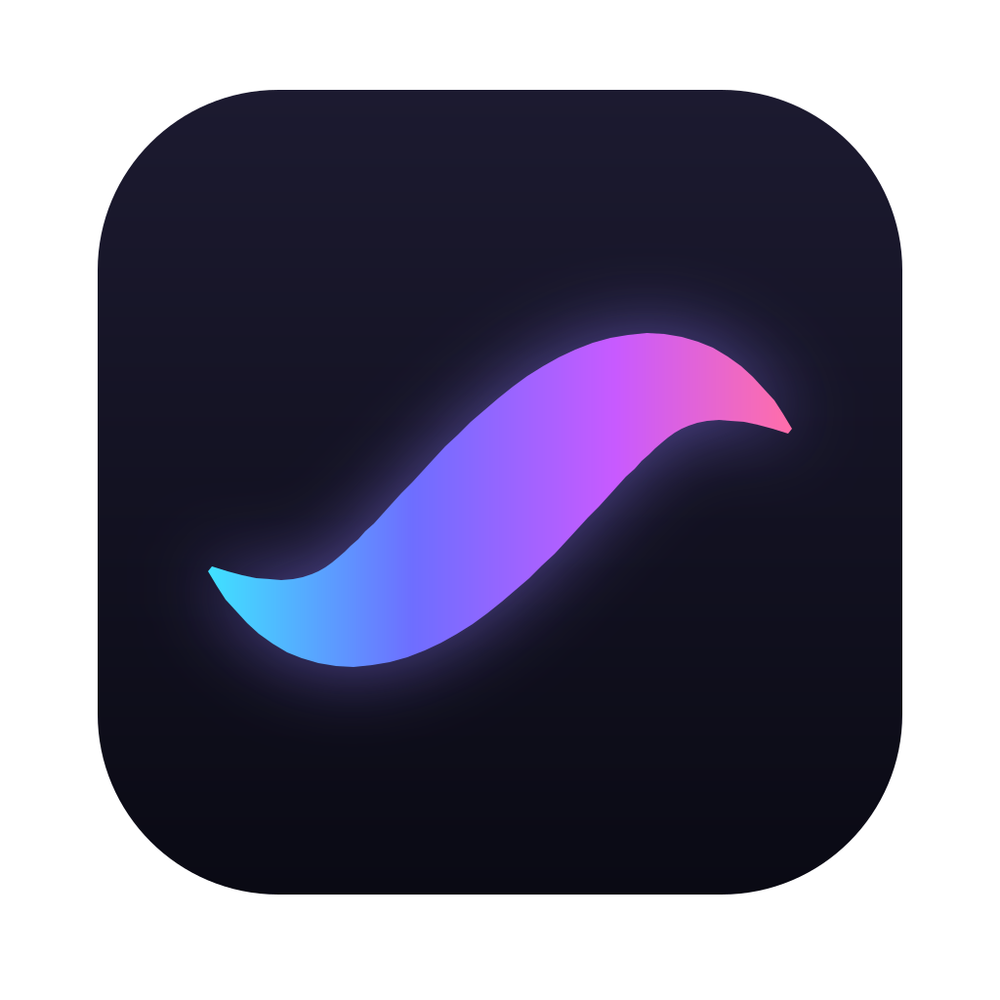

  

<h1 align="center">Swish</h1>

  <b>Contrôle ton Mac avec tes mains · Control your Mac with your hands</b> 
  <a href="https://chinw3.github.io/swish/">🌐 Site web</a> ·
  <a href="https://github.com/CHINW3/swish/releases/latest/download/Swish.zip">⬇️ Télécharger / Download</a>

---

Lève la main, balaie l'air ou fais 👍 — et ton Mac réagit. Change de bureau, contrôle ta musique, change de diapo, ou lance n'importe quelle macro. Tout se passe sur ton Mac : aucune image n'est envoyée sur Internet.

*Raise a hand, swipe the air or give a 👍 — and your Mac reacts. Switch desktops, control music, change slides or run any macro. Everything stays on your Mac.*

## Installation

1. [Télécharge Swish.zip](https://github.com/CHINW3/swish/releases/latest/download/Swish.zip), dézippe-le et glisse **Swish.app** dans **Applications**.
2. La première fois, macOS la bloque : **Réglages Système → Confidentialité et sécurité → Ouvrir quand même**.
3. Si macOS dit que l'app est endommagée, colle ceci dans Terminal : `xattr -cr /Applications/Swish.app`
4. Suis l'écran de bienvenue (caméra + Accessibilité).

**Il faut :** macOS 13 ou plus récent · Apple Silicon ou Intel · une caméra

---

Fait par Grégoire Leduc.
